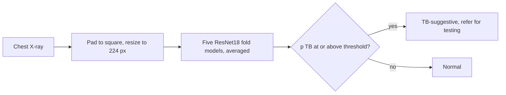
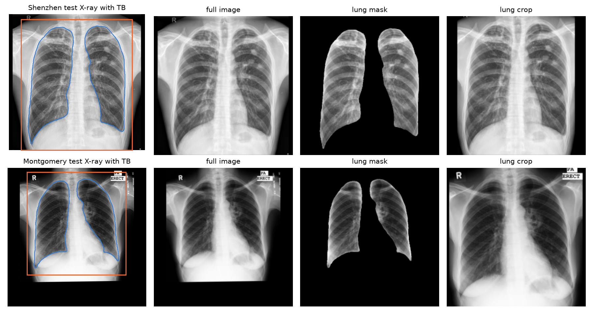
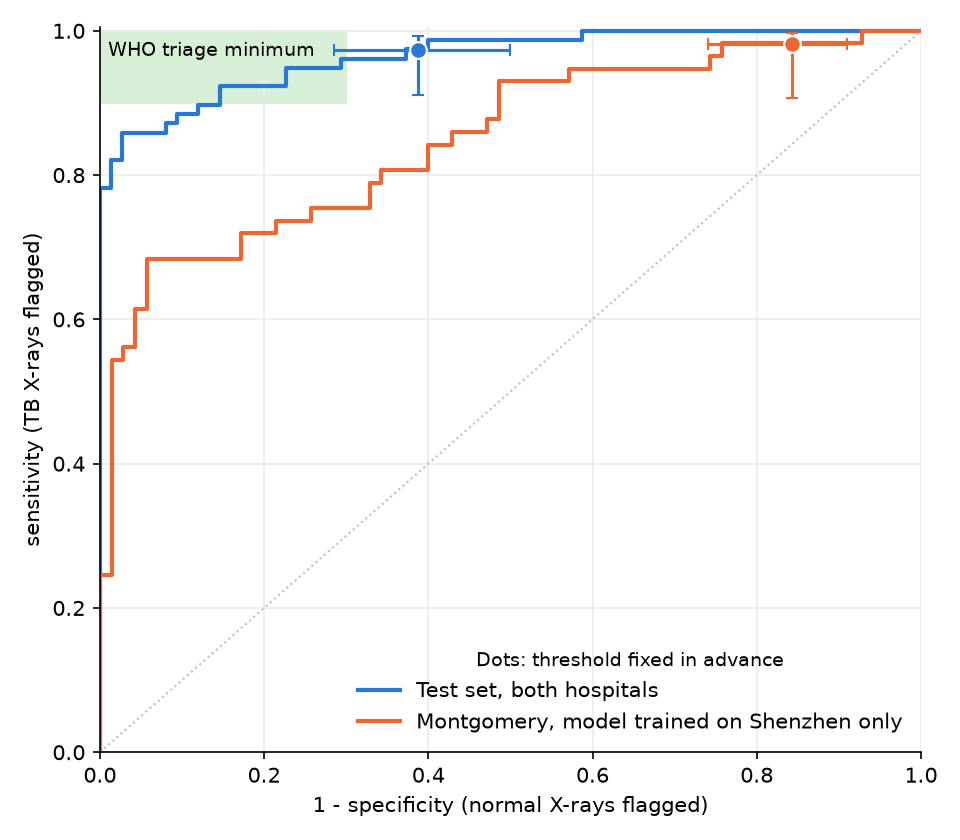

# TB-CXR Screening: Chest X-ray Triage Against the WHO Target

    

A tuberculosis triage model for chest X-rays, trained on 764 adult X-rays from two public hospital sets and served as a Dockerized FastAPI app. It asks three questions: how close a small model gets to the WHO accuracy target for a triage test, whether segmenting the lungs first helps, and how much of the result holds up at a hospital the model has never seen.

## Key results

1. **The model can reach the WHO triage minimum, but the threshold fixed in advance does not.** On 153 held-out X-rays it ranks TB above normal with an AUC of 0.964 (95% CI 0.936 to 0.986). At 90% sensitivity it clears 85% of normal X-rays, above the 70% minimum. The threshold chosen in cross-validation lands elsewhere on the same curve: it flags 97% of TB cases but clears only 61% of normal X-rays.
2. **Segmenting the lungs first does not help.** The U-Net finds the lungs well (median Dice 0.97 to 0.98), but a ResNet18 on the whole X-ray scores higher in cross-validation (AUC 0.922) than on the masked lungs (0.909) or a lung crop (0.903), so the served model skips segmentation. Age and hospital alone reach 0.559, so the model reads the image, not who the patient is or where the X-ray was taken.
3. **A new hospital needs its own threshold.** Trained on Shenzhen only and tested on Montgomery, the AUC falls to 0.849, and the Shenzhen threshold clears only 16% of normal X-rays. This is why the WHO asks for every CAD product to be calibrated locally.

## 1. The clinical problem and the WHO target

In high-burden, low-resource settings the bottleneck is radiologist time, not X-ray capacity. A triage tool reads every X-ray first, flags the ones that need a follow-up test and clears the rest. The WHO target product profile for such a test asks for:

| Requirement | WHO minimum | WHO optimal |
|---|---|---|
| Sensitivity | 90% | 95% |
| Specificity | 70% | 80% |

A missed TB case costs far more than an extra follow-up test, so the threshold is set for sensitivity first: it is the highest threshold that still flags 90% of TB cases in cross-validation, and the specificity is whatever that leaves.

The WHO measures these targets against a bacteriological test in the population that will actually be screened. These datasets have labels from clinical and radiology readings and about 50% TB, so the results here say whether the model reaches the WHO operating point on this benchmark, not whether it meets the WHO standard.

## 2. Pipeline



Before settling on the whole X-ray, the project compares it with two inputs that need a U-Net lung segmentation first:



The left column shows the predicted lungs (blue) and the crop box (orange) on two test X-rays with TB. The other columns show the three inputs:

- **Full image:** the whole X-ray, padded to a square so the anatomy keeps its shape.
- **Lung mask:** every pixel outside the predicted lungs set to black.
- **Lung crop:** a box around both lungs with a 5% margin. It keeps the lung behind the heart and the pleura, which the Montgomery masks leave out, and trims most of the shoulders and abdomen.

## 3. Does lung segmentation earn its place?

| Input | Out-of-fold AUC (95% CI) | Specificity at 90% sensitivity (95% CI) |
|---|---|---|
| Age and hospital only | 0.559 (0.513 to 0.604) | 12.1% (8.9 to 16.3) |
| Full image | **0.922** (0.897 to 0.942) | **75.8%** (70.7 to 80.4) |
| Lung mask | 0.909 (0.884 to 0.931) | 73.8% (68.6 to 78.5) |
| Lung crop | 0.903 (0.878 to 0.925) | 64.1% (58.5 to 69.3) |

All four rows are scored on the same 611 training X-rays with five-fold cross-validation, so the test set plays no part in the choice. A segmentation-based input would only replace the full image if it raised the out-of-fold AUC by at least 0.01.

Neither does. The full image comes first on both measures. Its lead over the lung mask is small and the intervals overlap, but segmentation adds a second model and gives nothing back, so the served model uses the whole X-ray. The age and hospital row is the shortcut check: if the image model were mostly picking up the patient's age or which hospital took the X-ray, this row would come close to it. It reaches 0.559, barely above chance.

The masks themselves are good, so this is not a segmentation failure:

| Lung segmentation on test X-rays | Images | Median Dice | Worst Dice |
|---|---|---|---|
| Montgomery | 25 | 0.982 | 0.961 |
| Shenzhen | 111 | 0.969 | 0.879 |

## 4. Results against the WHO target



| | Test set, both hospitals | Montgomery, trained on Shenzhen only |
|---|---|---|
| X-rays (TB) | 153 (78) | 127 (57) |
| AUC (95% CI) | 0.964 (0.936 to 0.986) | 0.849 (0.776 to 0.915) |
| Threshold, fixed in advance | 0.084 | 0.095 |
| Sensitivity at that threshold | 97.4% (91.1 to 99.3) | 98.2% (90.7 to 99.7) |
| Specificity at that threshold | 61.3% (50.0 to 71.5) | 15.7% (9.0 to 26.0) |
| Best specificity at 90% sensitivity | 85.3% (75.6 to 91.6) | 51.4% (40.0 to 62.8) |

The dots are the thresholds fixed in advance, with 95% intervals. The last row picks the threshold on the evaluated data itself, so it is the best case, not a result anyone could have planned for.

On the test set the curve passes through the WHO box, but the dot sits to its right. The threshold was set to catch 90% of TB cases in the out-of-fold scores, which come from single fold models. The test scores come from the average of the five fold models, and these separate the classes better (AUC 0.964 against 0.922 out of fold). So the same threshold catches 97% of TB cases and gives away specificity. The ranking is good enough for the WHO minimum; the threshold does not carry over.

At Montgomery the ranking itself is weaker. The AUC falls to 0.849, and even the best threshold clears only 51% of normal X-rays. The Shenzhen threshold flags 84% of them. The same gap shows inside the mixed test set: AUC 0.857 on its 25 Montgomery X-rays against 0.979 on the 128 from Shenzhen.

## Method

- **Cohort.** Montgomery County (USA) and Shenzhen (China) frontal chest X-rays, 800 in total. The WHO recommends CAD for people aged 15 and over, so the 36 children are left out; 33 of them are normal, which would also let a model learn "small chest means healthy".
- **Split.** 20% of the adults are held out as a test set, stratified by hospital and label. It is scored once, at the end.
- **Segmentation.** A U-Net with a ResNet18 encoder, trained at 256x256 on the training images that have lung masks from either hospital. It builds the lung mask and lung crop inputs; the served model does not need it.
- **Classifier.** A ResNet18 starting from ImageNet weights, with the first layer summed to one grey channel. It is trained for a fixed 8 epochs with light rotation, shift and contrast changes. There is no horizontal flip, because the heart is on the left.
- **Model selection without the test set.** Five-fold cross-validation on the training set gives an out-of-fold probability for every training image. These choose the input variant and the threshold. The test set is then scored by the average of the five fold models.
- **Threshold.** The highest one that flags 90% of the TB cases in the out-of-fold predictions. It travels with the model weights, so the API uses exactly the threshold that was evaluated.
- **Uncertainty.** 95% Wilson intervals for sensitivity and specificity, and 95% bootstrap intervals for AUC.

`outputs/metrics.json` holds every number in this README, and `data/processed/manifest.csv` lists every X-ray with its age, label and split.

## Inference API

| Endpoint | Method | Purpose |
|---|---|---|
| `/health` | `GET` | Confirms the models are loaded and returns the input variant and threshold. |
| `/predict` | `POST` | Runs the full pipeline on an uploaded X-ray and returns `tb_probability` and `tb_suggestive`. |

```bash
curl http://localhost:8000/health
curl -X POST http://localhost:8000/predict -F "file=@path/to/chest_xray.png"
```

An upload that is not an image gets an HTTP 400.

## CI/CD

`.github/workflows/ci.yml` runs on every push and pull request to `main`:

- **CI:** installs the pinned requirements and runs the tests. They use small synthetic images, so CI needs neither the data nor the model weights.
- **CD** (push to `main`, after the tests pass): builds the Docker image and pushes it to GHCR tagged `latest` and the commit SHA. The image downloads the weights from the `model-v1` GitHub release.

## Running it

Requires Python 3.11 or newer. The Montgomery and Shenzhen sets come from the U.S. National Library of Medicine ([Jaeger et al., 2014](https://qims.amegroups.org/article/view/5132/html)); the Shenzhen lung masks are a separate public annotation set. Place them as:

```
data/raw/Montgomery/MontgomerySet/{CXR_png, ClinicalReadings, ManualMask}
data/raw/ChinaSet_AllFiles/ChinaSet_AllFiles/{CXR_png, ClinicalReadings}
data/raw/shenzhen_masks/mask/CHNCXR_xxxx_x_mask.png
```

```bash
python -m venv .venv
.venv\Scripts\activate             # Windows (macOS/Linux: source .venv/bin/activate)
pip install -r requirements.txt
python -m tb_cxr.run               # about 3 hours on a laptop CPU, much less on an NVIDIA GPU
pytest                             # unit tests on synthetic data
uvicorn tb_cxr.api:app --port 8000 # serve the trained model

docker build -t tb-cxr-screening . # or: docker pull ghcr.io/abdullahifrh/tb-cxr-screening:latest
docker run -p 8000:8000 tb-cxr-screening
```

```
tb_cxr/
  config.py     paths, sizes, training settings, WHO targets
  data.py       cohort and split, image loading, lung box and classifier inputs
  models.py     U-Net, ResNet18 classifier, training, cross-validation, saving
  metrics.py    AUC, Wilson intervals, threshold selection, Dice
  plots.py      figures
  run.py        end-to-end pipeline
  api.py        FastAPI service
```

## Limitations

- The labels come from clinical and radiology readings, not from a bacteriological test, and the sets are about half TB, far more than any screening population. Sensitivity and specificity carry over to other prevalences; the share of flagged X-rays that really are TB does not.
- With 78 TB and 75 normal test X-rays, the intervals are wide: 8 points for sensitivity and 21 for specificity at the fixed threshold.
- The threshold comes from out-of-fold scores of single models but is applied to the average of five. Nested cross-validation, or calibrating the averaged scores, would give a threshold that carries over better.
- Two hospitals only. Before use anywhere else, the threshold would need local calibration, as the WHO recommends for every CAD product.
- Research project, not a diagnostic device.

## Data and citation

The Montgomery County and Shenzhen chest X-ray sets were released by the U.S. National Library of Medicine. If you use them, cite:

- Jaeger S, Candemir S, Antani S, Wang YX, Lu PX, Thoma G. Two public chest X-ray datasets for computer-aided screening of pulmonary diseases. *Quant Imaging Med Surg.* 2014;4(6):475-477.
- Candemir S, Jaeger S, Palaniappan K, et al. Lung segmentation in chest radiographs using anatomical atlases with nonrigid registration. *IEEE Trans Med Imaging.* 2014;33(2):577-590.

## License

MIT, see [LICENSE](LICENSE).
